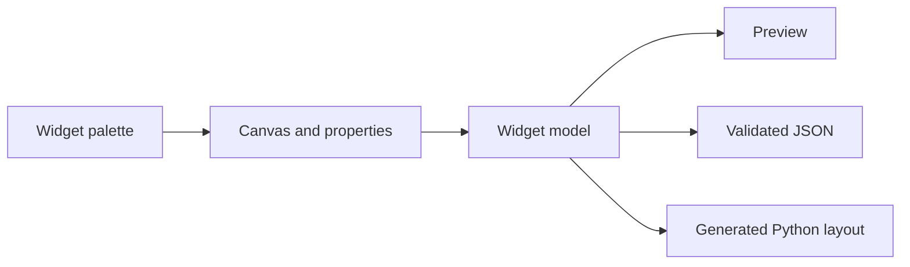

# TkForge | Visual Tkinter GUI Builder

**Design Python desktop interfaces visually, preview them, and export runnable Tkinter layout code.**

[](https://github.com/xtyledan/TkForge-Visual-Tkinter-GUI-Builder/actions/workflows/python-tests.yml) · [Screenshot](docs/screenshot.png) · [Engineering notes](docs/INTERVIEW_NOTES.md) · [MIT License](LICENSE)


*Actual application screenshot captured from Tkinter under a virtual desktop in GitHub Actions, not a design mockup.*

## Why it exists

Tkinter layout work often means repeatedly editing code and launching a window to see the result. TkForge provides a visual canvas for placing common widgets and generating the corresponding Python layout code.

## Features

- Add buttons, labels, entries, text fields, checkboxes, radio buttons, listboxes, comboboxes, frames and canvases.
- Drag, resize, select and edit widget properties in the designer.
- Preview layouts; save and load validated JSON project files.
- Export standalone Python/Tkinter source with safely escaped text values.
- Run automated code-generation, import-validation and canvas-redraw regression tests.

**Scope:** The export produces a starting layout, not application-specific handlers or business logic.

## Quick start

Requires a desktop environment and Python 3 with Tkinter installed.

```bash
git clone https://github.com/xtyledan/TkForge-Visual-Tkinter-GUI-Builder.git
cd TkForge-Visual-Tkinter-GUI-Builder
python main.py
```

On Windows, `py main.py` may be preferable. On Debian/Ubuntu, install Tkinter with `sudo apt install python3-tk` if needed. The editor does not require extra Python packages.

**Try it:** Add a Label and Button, drag them into place, change their text, select **Generate → Preview GUI**, then use **Generate Python Code**. Save the layout as JSON to reopen it later.

## Test

```bash
python -m unittest discover -s tests -v
```

[CI runs](https://github.com/xtyledan/TkForge-Visual-Tkinter-GUI-Builder/actions/workflows/python-tests.yml) check Python syntax and headless regressions. The [screenshot workflow](https://github.com/xtyledan/TkForge-Visual-Tkinter-GUI-Builder/actions/workflows/capture-demo.yml) launches a real Tkinter window under a virtual display. These checks are not a full GUI usability test.

## Design



| Component | Role |
| --- | --- |
| [main.py](main.py) | Desktop editor, canvas handling, previews and code generation |
| [project_format.py](project_format.py) | Validated project import/export format |
| [tests](tests) | Regression tests without a display |
| [docs/INTERVIEW_NOTES.md](docs/INTERVIEW_NOTES.md) | Technical choices and known limitations |

**Tradeoff:** Absolute positioning maps simply from the canvas to Tkinter's `.place()`, but generated windows do not automatically reflow when resized.

## Limitations and roadmap

No packaged release, web deployment or comprehensive automated visual-interaction suite. Generated widgets have no application-specific event handling. Future improvements include keyboard-first editing, responsive layout managers and broader GUI integration tests.

**License:** [MIT](LICENSE). [Portfolio](https://xtyledan.github.io/) · [GitHub profile](https://github.com/xtyledan)
