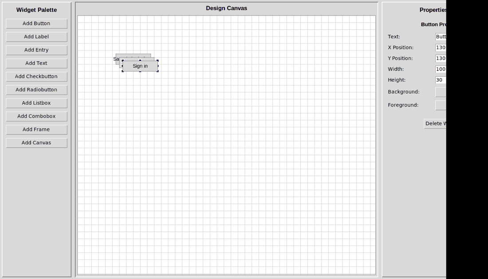

# TkForge

**Visual editor and Python source generator for Tkinter desktop layouts.**

TkForge addresses the repetitive edit-run cycle involved in arranging basic Tkinter interfaces. Create a layout on a canvas, adjust widget properties, preview the UI, save it as JSON, and generate a standalone Python script.

[](https://github.com/xtyledan/TkForge-Visual-Tkinter-GUI-Builder/actions/workflows/python-tests.yml)



*Actual TkForge interface captured by the [desktop screenshot workflow](https://github.com/xtyledan/TkForge-Visual-Tkinter-GUI-Builder/actions/workflows/capture-demo.yml). This is not a mockup.*

## What works

- Add ten types of Tkinter widgets from a palette, including buttons, labels, entries, frames, and canvases.
- Move and resize visual representations of widgets on a design canvas.
- Edit positioning, dimensions, colors, and text through a properties panel.
- Save and load designs as JSON.
- Preview layouts and export Python/Tkinter source code.
- Escape text and color string literals in exported Python code, including embedded quotes, newlines, and backslashes.

The generated code provides widget creation and placement, **not** application-specific callbacks, validation, or business logic.

## Run locally

Requirements: Python 3 with Tkinter installed and a desktop session. CI runs its headless unit tests on Python 3.11; full GUI operation has not been automatically tested across platforms.

```bash
git clone https://github.com/xtyledan/TkForge-Visual-Tkinter-GUI-Builder.git
cd TkForge
python main.py
```

On Windows, the Python launcher may be `py main.py`. On Debian/Ubuntu, Tkinter may require `sudo apt install python3-tk`. No third-party Python packages are required by the current application.

**Typical workflow:** Launch the editor → Add a widget → Drag or resize it → Change its properties → Open *Generate → Preview GUI* → Export Python code or save the JSON design.

## Test

```bash
python -m unittest discover -s tests -v
```

GitHub Actions also checks Python syntax and runs headless regression tests on pushes and pull requests. Tests verify generated Python syntax for all ten widget types and proper escaping of special characters. They **do not** cover pointer interaction, screen rendering, or the full desktop workflow.

## Architecture

| Part | Responsibility |
| --- | --- |
| `main.py` | Tkinter editor, state management, canvas interaction, JSON persistence, previews, and Python code generation |
| `tests/test_code_generation.py` | Headless regression coverage of generated Python |
| `.github/workflows/python-tests.yml` | Automated syntax checks and unit tests |
| `docs/INTERVIEW_NOTES.md` | Design choices, tradeoffs, and limitations |

Widgets are held as dictionaries with identifiers, types, positions, dimensions, styling, and text. Exported code uses Tkinter's `.place()` layout manager because absolute positions map directly to the design canvas.

## Engineering decisions and limitations

- **Python + Tkinter:** Suitable for a self-contained desktop editor, but less flexible for responsive layouts.
- **JSON persistence:** Easy to inspect and version for a single-user design document; no database is needed.
- **Absolute positioning:** Simple to visualize and export, but generated windows do not reflow their content when resized.
- **Escaped code generation:** Python string literals use `repr` to avoid producing invalid syntax for normal quoted or multiline text.
- **Current limitations:** Project JSON is schema-validated and identifiers follow the supported widget naming rules; the UI still has no automated end-to-end interaction tests. The app is not hosted on the web.

See [engineering interview notes](docs/INTERVIEW_NOTES.md) for implementation tradeoffs and next steps.

## Evidence and scope

This repository contains an executable desktop application, its full source, and tests. It has a verified screenshot generated from a real desktop run, but no published binary, downloadable release, demo recording, or public web deployment. Do not treat the regression test badge as proof of production readiness.

## License

[MIT License](LICENSE).
